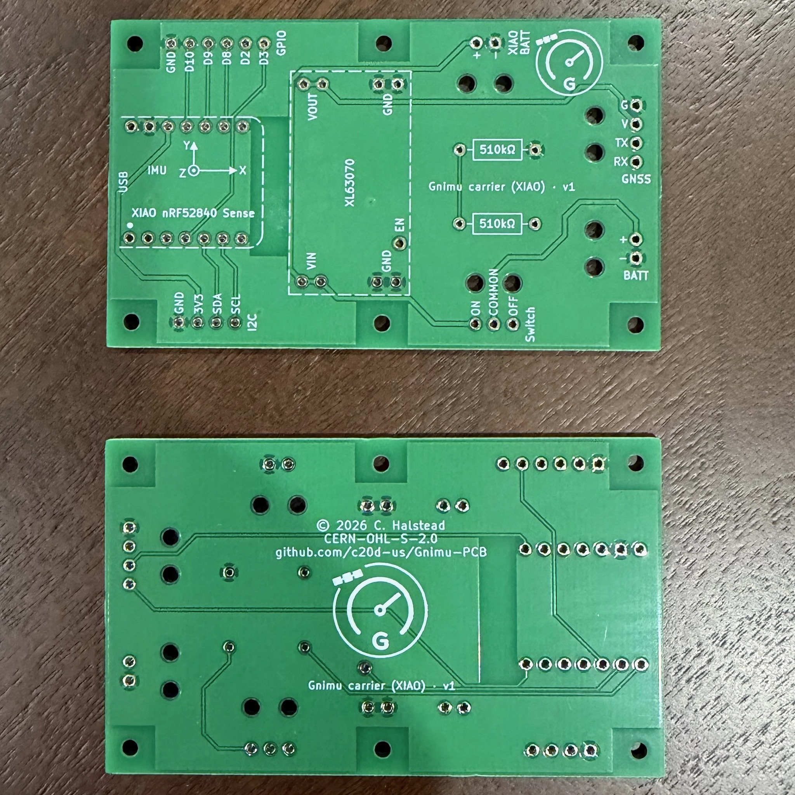
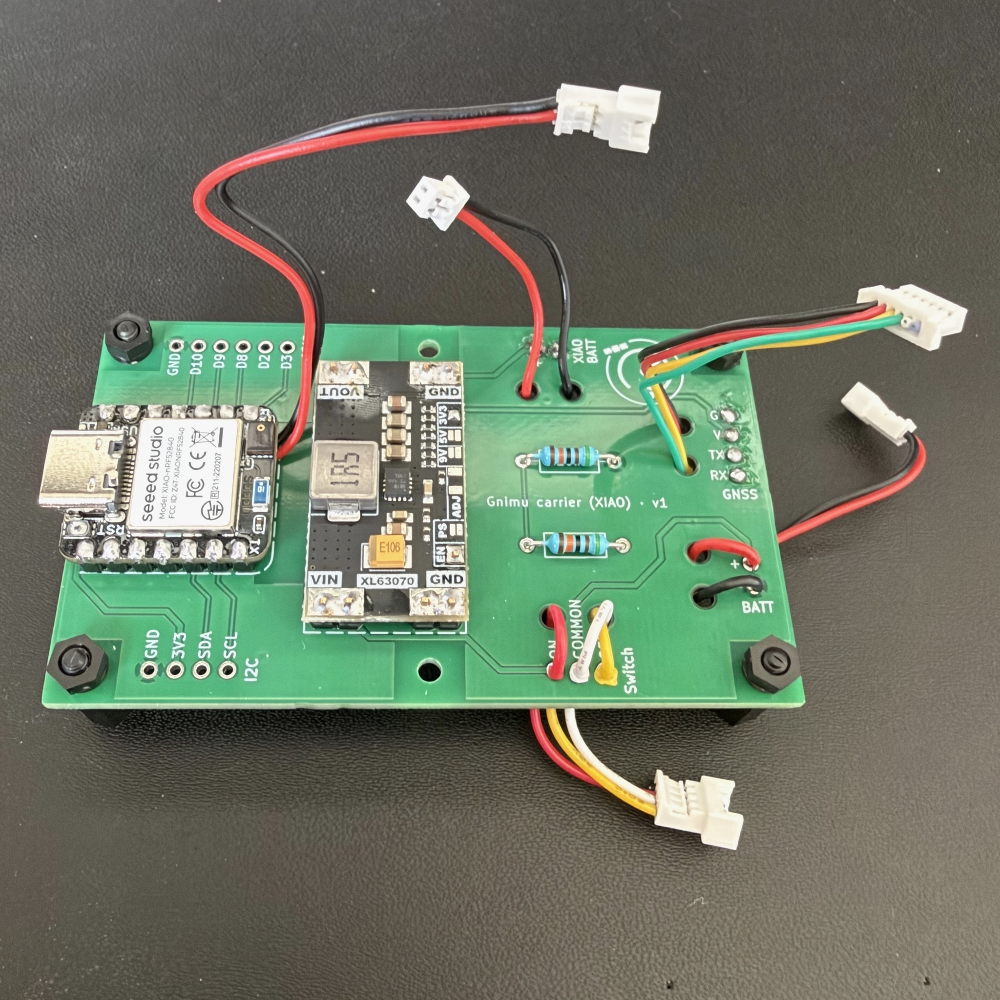

<p>
  
  <picture>
    <source media="(prefers-color-scheme: dark)" srcset="branding/wordmark/gnimu-wordmark-transparent-white.svg">
    
  </picture>
</p>

# Gnimu PCBs


Circuit boards for [Gnimu](https://github.com/c20d-us/Gnimu), a GNSS+IMU motorsports telemetry device that emulates the streaming-telemetry function of a RaceBox Mini over BLE.

This repository holds the hardware only: KiCad projects, the shared symbol and footprint library, and fabrication outputs. The firmware, the bill of materials, and the step-by-step build guides live in the [Gnimu](https://github.com/c20d-us/Gnimu) repository.

<table>
  <tr>
    <td align="center" valign="top" width="50%">
      <br>
      <sub>The bare carrier (revision v1), front and back.</sub>
    </td>
    <td align="center" valign="top" width="50%">
      <br>
      <sub>Loaded: the XIAO, the XL63070 regulator, the two resistors, and leads.</sub>
    </td>
  </tr>
</table>

---

## Boards

| Board | Revision | MCU | Status |
|---|---|---|---|
| [**Gnimu carrier (XIAO)**](boards/gnimu/) | [v1.1](boards/gnimu/gnimu-carrier-xiao-v1.1/) | Seeed XIAO nRF52840 Sense | Current design. Gerbers not yet added. |
| | [v1](boards/gnimu/gnimu-carrier-xiao-v1/) | Seeed XIAO nRF52840 Sense | Fabricated and built. Gerbers included. |
| [**Gnimu CAN carrier (XIAO)**](boards/gnimu-can/) | [v1](boards/gnimu-can/gnimu-can-xiao-v1/) | Seeed XIAO ESP32C6 | Work in progress. Schematic only. |

Every board is two-layer and through-hole only, built around off-the-shelf modules that solder straight onto it.

---

## Repo layout

```
boards/
  gnimu/                 The GNSS+IMU carrier, one folder per revision
  gnimu-can/             The CAN carrier (work in progress)
libraries/               Shared KiCad symbols (Gnimu.kicad_sym) and footprints (Gnimu.pretty)
silkscreen-logos/        The Gnimu logo as SVG, sized for silkscreen
branding/                The Gnimu icon and wordmark used in this README
images/                  Board photos
```

Each revision folder is a self-contained KiCad project. Where a revision has been sent out for fabrication, its `fabrication/` folder holds the gerbers as they were ordered.

---

## Opening the projects

The projects are KiCad 10 files. Clone the repository and open any `.kicad_pro`.

The custom parts come from [`libraries/`](libraries/), which each project finds through its own `sym-lib-table` and `fp-lib-table` using a path relative to the project. There is nothing to install or configure, provided the folder layout is kept as it is.

---

## License & Terms

This source describes Open Hardware and is licensed under [CERN-OHL-S v2][CERN-OHL-S_v2]. You may redistribute and modify this source and make products using it under the terms of this license. Please see the text of CERN-OHL-S v2 for all applicable conditions that apply.

This source is distributed WITHOUT ANY EXPRESS OR IMPLIED WARRANTY, INCLUDING OF MERCHANTABILITY, SATISFACTORY QUALITY AND FITNESS FOR A PARTICULAR PURPOSE.

The Gnimu firmware is a separate work under its own license; see the [Gnimu](https://github.com/c20d-us/Gnimu) repository.

[CERN-OHL-S_v2]: https://ohwr.org/cern_ohl_s_v2.txt
