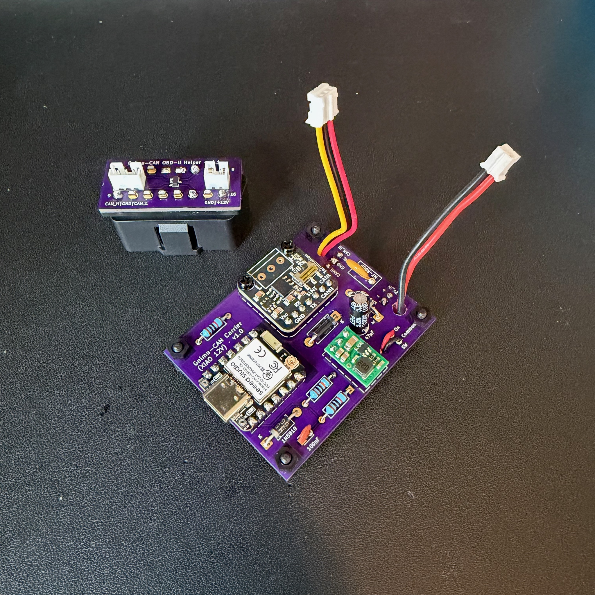

# Gnimu-CAN

Boards for Gnimu-CAN, a work-in-progress telemetry reader that takes data from a car's CAN bus through its OBD-II port, or directly from the CAN bus's CAN-H/CAN-L. The device uses a Seeed XIAO ESP32C6 MCU with an Adafruit CAN Pal transceiver. It runs either from its own LiPo battery or from the car's 12V supply, depending on which carrier it's built on.

> [!NOTE]
> **Work in progress.** Anything here may change. The OBD-II helper and the 12V carrier have been fabricated and assembled; the LiPo carrier hasn't been sent to a fab.

## Boards

| Board | Folder | Status |
|---|---|---|
| [**OBD-II helper v1.0**](gnimu-can-obd-helper-v1.0/) | `gnimu-can-obd-helper-v1.0/` | Fabricated by OSH Park. Fit and test assembly confirmed. J2's +12V and GND pins are reversed relative to stock red/black leads; see its README. |
| [**OBD-II helper v1.1**](gnimu-can-obd-helper-v1.1/) | `gnimu-can-obd-helper-v1.1/` | Fabricated by OSH Park and assembled on a plug. J2 swapped to pin 1 GND, pin 2 +12V; ground pour on both layers. |
| **CAN carrier (XIAO), LiPo v1.0** | [`gnimu-can-carrier-xiao-lipo-v1.0/`](gnimu-can-carrier-xiao-lipo-v1.0/) | Layout complete and passing DRC. Not yet ordered. |
| [**CAN carrier (XIAO), 12V v1.0**](gnimu-can-carrier-xiao-12v-v1.0/) | `gnimu-can-carrier-xiao-12v-v1.0/` | Fabricated by OSH Park and assembled. Gerbers in [`fabrication/`](gnimu-can-carrier-xiao-12v-v1.0/fabrication/). |

### OBD-II helper

A small board that fits over the exposed pins on the back of a straight-pin OBD-II plug and breaks out CAN_H, CAN_L and GND to a 3-pin JST PH socket, and 12V and GND to an optional 2-pin one, with a TVS diode on the CAN lines. See [its README](gnimu-can-obd-helper-v1.0/).

### CAN carriers (XIAO)

Two carriers in the same style as the [Gnimu carrier](../gnimu/): off-the-shelf modules on a simple two-layer, through-hole board. They share the same CAN section and differ only in how they're powered:

- **LiPo:** the XIAO runs from a 3.7V LiPo through its battery pads. Only CAN_H, CAN_L and GND come from the car.
- **12V:** the XIAO runs from the car's 12V, through a fuse, a TVS diode and a 5V buck regulator. It takes CAN_H, CAN_L, GND and +12V from the helper's two sockets.

All the off-board connections are plated holes for soldering leads, typically JST PH pigtails that plug into the helper. Unplated strain-relief holes (SR1, SR2…) sit beside the pads. The four corner holes are for M2.5 standoffs.

#### Shared CAN section

| Ref | Part | Role |
|---|---|---|
| **U1** | Seeed XIAO ESP32C6 | MCU, by its 14 edge pins. |
| **U2** | Adafruit CAN Pal | CAN transceiver breakout, powered from the XIAO's 3V3. |
| **R1** | 10kΩ | Pulls `CAN_SILENT` up, so the transceiver stays in listen-only mode until the firmware drives it low. |
| **J1** | 3 wire pads | CAN from the OBD-II helper: 1 CAN_H · 2 GND · 3 CAN_L, the same order as the helper's J3. |

| XIAO pin | Net | Goes to |
|---|---|---|
| D0/A0 | `VBAT_SENSE` (LiPo) or `V12_SENSE` (12V) | Supply voltage divider tap |
| D8 | `CAN_SILENT` | CAN Pal S (high = listen-only) |
| D9 | `CAN_TX` | CAN Pal TX |
| D10 | `CAN_RX` | CAN Pal RX |

The CAN Pal's own termination switch is left off: the car's bus is already terminated.

#### LiPo carrier

48 × 44 mm. All parts are through-hole.

| Ref | Part | Role |
|---|---|---|
| **R2, R3** | 100kΩ + 100kΩ | Battery voltage divider to D0/A0 (÷2). |
| **C1** | 100nF | Steadies the divider tap for the ADC. |
| **J2** | 2 wire pads | Power switch. |
| **J3** | 2 wire pads | LiPo battery. |
| **J4** | 2 wire pads | Leads to the XIAO's battery pads. |

The battery runs through the switch to `VSYS`, which feeds the XIAO's battery pads and the divider, so the switch turns off everything, divider included.

The XIAO's built-in charger works through those same battery pads, so the LiPo charges over USB only while the switch is on. With the switch off, the battery is fully disconnected and nothing drains it.

#### 12V carrier

56 × 44 mm. All parts are through-hole. The XIAO runs from the car's 12V through a PTC fuse (F1), a TVS diode (D1), a reverse-polarity Schottky (D2), the power switch (J3) and a Pololu D24V7F5 5V regulator (U3), with a second Schottky (D3) into the XIAO's 5V pin so USB can't feed back into the regulator. A 100k/10k divider brings the switched 12V to D0/A0.

See [its README](gnimu-can-carrier-xiao-12v-v1.0/) for the connections, power path, parts list and assembly notes.

The symbols, footprints and 3D models for all the boards are in the shared [`libraries/`](../../libraries/) folder.
